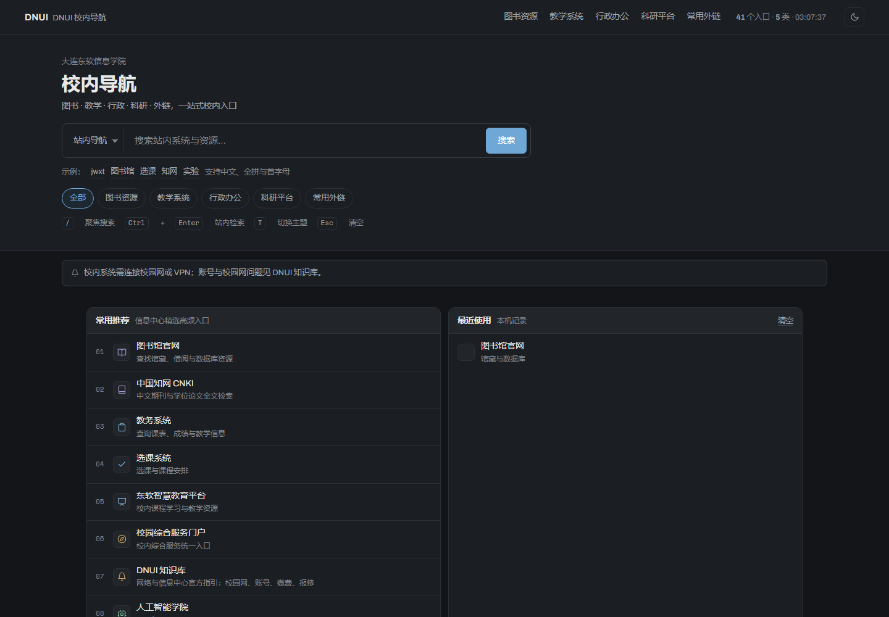
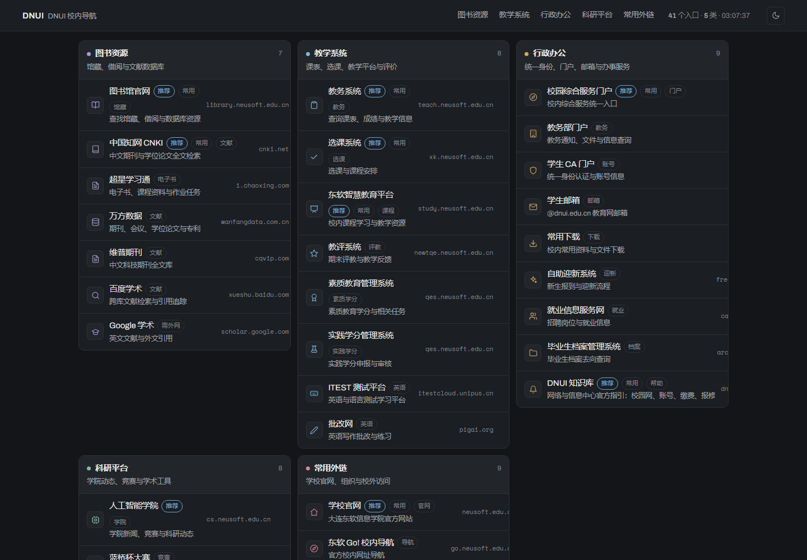

# gonav · DNUI 校内导航

大连东软信息学院校内外入口聚合页。Go 服务端渲染，单二进制部署，前端模板、字体与 CSS/JS 全部 `go:embed` 打包。
同一个进程还托管 **navkit**（可自定义导航 / 新标签页）与供**主网关**调用的 **gRPC 服务**。

界面走**克制的日常工具风**：灰白底、1px 细线、小圆角、一个低调蓝，没有入场动画、噪点、跑马灯或自制光标；
零外部请求（字体自托管）。





## 快速开始

```powershell
cd D:\git\gonav
go run .                              # http://127.0.0.1:8080
.\run.ps1 -Addr 127.0.0.1:8090        # 编译并运行
go run . -debug                       # 开发模式，改模板/CSS 刷新即生效
```

| 参数 | 默认值 | 说明 |
| --- | --- | --- |
| `-addr` | `:8080` | 监听地址（`0.0.0.0:8123` 为全网卡） |
| `-config` | `config/links.json` | 链接配置 |
| `-stats` | `data/stats.json` | 点击统计 |
| `-watch` | `3s` | 配置热更新间隔，`0` 关闭 |
| `-debug` | `false` | 开发模式（模板与资源从磁盘读，禁用缓存） |
| `-web-root` | `internal/web` | 开发模式下的资源目录 |

### 让局域网 / 手机也能访问

```powershell
.\gonav.exe -addr 0.0.0.0:8123          # 监听所有网卡
.\run.ps1 -Lan -Port 8123               # 等价写法，并打印可用地址 + 检查防火墙
```

手机连同一个 Wi-Fi，打开脚本打印出的地址（如 `http://192.168.221.148:8123/`）。
Windows 默认拦截入站，**首次需要以管理员身份放行一次**：

```powershell
New-NetFirewallRule -DisplayName "gonav (TCP 8123)" -Direction Inbound -Protocol TCP -LocalPort 8123 -Action Allow -Profile Any
```

`run.ps1 -Lan` 会自检该端口是否已有放行规则，缺失时直接把上面这行命令打给你。

## 界面构成

```
┌ 顶栏（吸顶）  DNUI 校内导航 │ 图书 教学 行政 科研 外链 │ 41 个入口 · 5 类 · 时钟 │ ☾ ┐
├ 首屏         大连东软信息学院 / 校内导航 / 副标题                                    │
│              [站内导航 ▾] [ 搜索框              ] [搜索]                            │
│              示例：jwxt 图书馆 选课 知网 实验 · 支持中文、全拼与首字母                │
│              [全部] [图书资源] [教学系统] [行政办公] [科研平台] [常用外链]            │
├ 横条         常用推荐 / 我的收藏 / 最近使用 / 热门入口（四张小面板）                  │
├ 分类面板     每类一块：色点 + 名称 + 入口数 + 说明，内部逐条图标 / 名称 / 描述 / 标签  │
└ 页脚         维护方 · 版本 / 配置路径 / 更新时间 / 累计点击 · 回到顶部                ┘
```

## gRPC 契约（供主网关调用）

契约文件：`api/proto/navkit/v1/navkit.proto`，包名 `dnui.navkit.v1`，生成的代码在 `gen/navkit/v1/`（已提交，构建不需要 buf）。

```powershell
.\gonav.exe -addr 0.0.0.0:8123 -grpc-addr 0.0.0.0:9190   # 两个端口同进程
.\gonav.exe -grpc-disable                                 # 不需要网关时关掉
```

| 方法 | 状态 | 说明 |
| --- | --- | --- |
| `Health` | 已实现 | 状态 ok/degraded（热更新失败时降级但仍服务上一版可用配置）、revision、入口/分类数 |
| `GetServerInfo` | 已实现 | 版本、地址、配置路径、**能力清单**（网关据此避免踩 Unimplemented） |
| `GetCatalog` | 已实现 | 全量快照；支持 `include_links`、按分类取、`known_revision` 增量 |
| `ListCategories` | 已实现 | 只回分类骨架（不含入口），用于构建分类切换器 |
| `Search` | 已实现 | 复用服务端加权检索，**支持中文 / 全拼 / 首字母** |
| `GetStats` | 已实现 | 累计点击与 Top N |
| `PutCatalog` | 已实现 | 网关下发全量配置：同一套校验 → 原子落盘 → 版本递增 → 通知订阅者；支持 `dry_run` 与 `expected_revision` 乐观并发 |
| `PatchLink` | 已实现 | 单条 upsert / delete，走与全量下发相同的写入路径 |
| `WatchCatalog` | 已实现 | server streaming：落后时补推当前快照，之后每次变更推送新快照，30s 心跳保活 |

**同步语义**（网关对接时必须依赖这几条）：

- 每份快照带单调递增 `revision`、`content_hash`(sha256)、`updated_at`、`source`(file/gateway)
- `GetCatalog{known_revision}` 命中时只回 `not_modified=true`，不重复传数据
- 写入走**同一条校验链路**：`PutCatalog` 先序列化成配置文件形状，再用 `catalog.Decode` 校验，最后原子落盘；非法配置返回 `InvalidArgument` 且**不动线上可用的旧配置**
- 错误码：未知分类/入口 `NotFound`、参数越界与校验失败 `InvalidArgument`、`expected_revision` 不匹配 `Aborted`
- 内网**暂不鉴权**，但拦截器已留插槽（token / mTLS 接上即可，方法签名不用动）

**反向回调**（navkit → 主网关）：`internal/gatewayclient` 定义了事件模型与调用点，
`-gateway-addr` + `-gateway-callback` 开启。**当前是骨架**：主网关的服务名/鉴权/proto 还没定，
所以 `Emit` 只记日志、默认关闭；契约到手后只需替换 `grpcClient.Emit` 的实现，调用方（grpcsvc / web）不用改。
已接线的事件：配置变更（`PutCatalog`/`PatchLink` 成功后）与入口点击（`/go/{id}`）。

**自查**（已注册反射，网关不持有 proto 也能探查）：

```powershell
$g = "$env:USERPROFILE\go\bin\grpcurl.exe"
& $g -plaintext 127.0.0.1:9190 list
'{"includeLinks":true}' | & $g -plaintext -d '@' 127.0.0.1:9190 dnui.navkit.v1.NavkitService/GetCatalog
```

> Windows PowerShell 5.1 会把 `-d '{"a":true}'` 里的双引号吃掉，必须走 `-d '@'` + 管道传 JSON。

**重新生成 proto 代码**（改了 `.proto` 之后）：

```powershell
$env:GOPROXY = "https://goproxy.cn,direct"   # proxy.golang.org 在本机不可达
go install google.golang.org/protobuf/cmd/protoc-gen-go@latest
go install google.golang.org/grpc/cmd/protoc-gen-go-grpc@latest
go install github.com/bufbuild/buf/cmd/buf@latest
$env:PATH += ";$env:USERPROFILE\go\bin"
buf generate
```

## 功能

- **拼音 / 首字母检索**：`jwxt` → 教务系统、`tushuguan` → 图书馆官网、`nsfc` → 国家自然科学基金委；服务端加权检索，前端用同一份数据实时过滤并高亮命中处。
- **我的收藏**：星标加入/移出，拖拽手柄排序（触屏用 `‹ ›` 按钮），顺序存本机。
- **两个入口来源**：常用推荐来自配置 `pinned`，热门入口按服务端点击量排序；链接统一走 `/go/{id}` 计数后 302。
- **深 / 浅色**：默认浅色，跟随系统并记忆；`T` 键切换。
- **快捷键**：`/` 聚焦搜索、`Ctrl+Enter` 站内检索、`T` 切主题、`Esc` 清空。
- **无障碍与降级**：跳转链接、语义标签、`aria-pressed`、可见焦点环；无 JS 时表单照常提交、内容完整可读。

## 接口

| 方法 | 路径 | 说明 |
| --- | --- | --- |
| GET | `/` | 首页 |
| GET | `/search?q=&engine=` | 站内结果页 / 公网引擎跳转 |
| GET | `/go/{id}` | 计数并跳转 |
| GET | `/api/links[?category=id]` | 配置 JSON |
| GET | `/api/search?q=&limit=` | 检索 JSON |
| GET | `/api/stats` | 累计点击与 Top20 |
| GET | `/api/userscripts` | 极客模式用户脚本列表 |
| PUT | `/api/userscripts/{id}` | 保存用户脚本（含权限声明） |
| DELETE | `/api/userscripts/{id}` | 删除用户脚本 |
| GET | `/navkit-userscript/{id}.html` | 宿主导管的用户脚本包装页（样式/脚本均外链） |
| GET | `/navkit-userscript/{id}.js` | 用户脚本本体 |
| GET | `/healthz` | 健康检查 |

## navkit（可自定义导航 · M1）

gonav 现在同时托管第二个应用：**navkit**，一个纯前端、可离线运行的自定义导航 / 新标签页。

```powershell
.\gonav.exe -addr 0.0.0.0:8123        # 然后访问 http://127.0.0.1:8123/navkit/
```

| 能力 | 说明 |
| --- | --- |
| 首次启动选主题 | 4 套：克制灰白 / 墨黑 / 毛玻璃 / 纸张；主题就是一组 CSS 变量，随时可换 |
| 图标格子 | 增删改、**拖拽排序**（含键盘排序）、分组、多页面；图标支持 emoji / 汉字 / 图片 URL |
| 搜索 | 多引擎切换 + 自定义引擎（模板含 `%s`）；输入即筛选本页图标，`/` 聚焦、`Esc` 清空 |
| 壁纸 | 6 张内置 + 纯色 + 渐变 + **上传本地图片**（存 IndexedDB，可调模糊与压暗） |
| **插件系统** | 见下节。内置时钟 / 待办 / gonav 数据源三个示例 |
| **命令面板** | `Ctrl/Cmd+K`：动作、主题、页面跳转、打开图标全在里面，↑↓ + Enter 纯键盘完成 |
| **编辑模式** | 顶栏 ✥ 切换：分组上下移、内联"添加组件"、组件尺寸 ±（列/行）、虚线描边提示可编辑 |
| **自定义样式** | 配置面板 → **CSS 变量覆盖**（主题之上的一层）→ **主题包**导出/导入 → **极客模式**（自定义 CSS / 沙箱用户脚本） |
| **中英双语** | 设置里切换，`<html lang>` 与全部界面文案跟随，选择持久化 |
| 数据 | 全部存本机 IndexedDB，**JSON 导入导出**（体积允许时内嵌壁纸），一键恢复默认 |

### 插件化

三套机制共用一份清单（`plugin.json`，`apiVersion: 1`）：

| 类型 | 形态 | 安全边界 |
| --- | --- | --- |
| `kind: "widget"` | HTML+JS 入口，跑在 `sandbox="allow-scripts"` 的 iframe 里，**不给 `allow-same-origin`** | 不透明源：读不到宿主 DOM / cookie / IndexedDB，只能走 postMessage RPC；每个能力都要在清单里声明权限 |
| `kind: "source"` | 声明式：清单给出 `entry`（JSON 地址）+ `network:<origin>` 权限 | 由宿主取数并映射成图标，第三方**不需要**在我们的页面里执行代码 |
| 主题包 | `theme.json`（CSS 变量）+ 壁纸，可分享 | 纯数据，**永不携带 JS** |

权限清单：`storage`（按 pluginId 隔离的键值存储）、`theme:read`、`search:query`、`network:<origin>`。
宿主侧逐条校验，未声明的方法直接拒绝——这条有专门的浏览器测试。

内置三个示例：**时钟**（`theme:read`）、**待办**（`storage`，刷新后仍在）、**gonav 数据源**（一键把 41 个校内入口导入成 5 个分组）。

安装方式：内置目录一键装，或粘贴 `https://…/plugin.json` 从 URL 装（会展示要授予的权限）。

### 自定义样式的四层

1. **配置面板**：主题色 / 圆角 / 间距 / 模糊 / 图标尺寸 / 壁纸
2. **CSS 变量覆盖**：面板上直接改 10 个令牌，改的是主题之上的一层，可一键清除
3. **主题包**：把当前令牌导成 `navkit-theme.json` 分享给别人，导入即应用
4. **极客模式**：
   - **自定义 CSS** 通过 `adoptedStyleSheets`（CSSOM）注入——**不需要**放松页面 CSP
   - **自定义 JS** 不在主页面执行：PUT 到 `/api/userscripts/{id}` 后，宿主为它生成包装页
     （`/navkit-userscript/{id}.html`，样式与脚本都走外链），navkit 再以 `sandbox="allow-scripts"` 的 iframe 加载。
     脚本同样要声明权限，宿主逐条校验。这样既不放松 CSP，也没有内联脚本/样式。

**构建**（产物已提交，只有改了前端才需要跑）：

```powershell
cd navkit; npm install; npm run build   # 产物直接落到 internal/web/assets/navkit
cd ..; go build -o gonav.exe .          # go:embed 自动打包进去
```

托管方式：`/navkit` → 301 到 `/navkit/`；命中静态资源直出，`assets/*` 带内容哈希可长期缓存，未知路径回落 `index.html`（SPA），缺失的 `assets/*` 老实 404。navkit 路径下的 CSP 单独放开 `img-src 'self' data: blob: https:`（用户自填图标与上传壁纸需要），gonav 自己的页面仍保持严格。

**M2–M4 全部完成**：gRPC 写契约与订阅、插件运行时与权限沙箱、可视化布局编辑模式、命令面板与全键盘操作、
CSS 变量编辑器、中英 i18n、网关反向回调骨架、主题包、数据源插件、极客模式（CSS + 沙箱用户脚本）。

> 唯一保留的取舍：**校验/诊断类文案**（`schema.ts` 里的 zod 报错）统一英文，它们是给排查问题看的，
> 不参与界面语言切换。

## 目录

```
gonav/
├── main.go                    入口：HTTP + gRPC + 优雅关闭
├── config/links.json          链接配置（41 条，5 类，热更新）
├── data/stats.json            点击统计（运行时生成）
├── run.ps1                    编译运行脚本（-Lan 供局域网访问）
├── api/proto/navkit/v1/       主网关调用契约（.proto）
├── gen/navkit/v1/             buf 生成的 Go 代码（已提交）
├── buf.yaml / buf.gen.yaml    proto 生成配置
├── navkit/                    自定义导航前端（Vite + React + TS）
│   └── src/{lib,components}/  数据层 / 图标格子 / 设置抽屉 / 首次启动
├── internal/catalog/          配置模型、校验、热更新、加权检索（含拼音）
├── internal/pinyin/           内嵌读音表 + 全拼/首字母
├── internal/grpcsvc/          gRPC 服务、拦截器、映射
├── internal/gatewayclient/    反向回调主网关（骨架，默认关闭）
├── internal/search/           搜索引擎与 URL 构造
├── internal/stats/            点击计数与原子落盘
├── internal/web/              HTTP 层、模板、CSS/JS、图标、高亮
│   └── assets/                字体 + navkit 构建产物（已提交）
└── tools/genpinyin/           读音表生成器
```

## 实现要点

- **克制是写进测试的契约**：`TestRestrainedShell` 会断言首页**不含**开场遮罩、自制光标、滚动进度、跑马灯、噪点、循环词与巨型字标，并断言样式表里没有荧光色（`#d8ff00`）、`mix-blend-mode` 与任何 `@keyframes`；浏览器套件再加一层「运行时 0 个动画 + 强调色为 `#2f6f9f` + 边框 1px + 无硬投影」。想加回炫技元素会直接被测试拦下。
- **严格 CSP 下的实现**：服务端下发 `style-src 'self'`（不含 `unsafe-inline`），因此模板里**没有任何内联 `style` 属性**，JS 只通过 CSSOM 赋值，测试也会检查这一点。React 的 `style={{}}` 同样走 CSSOM，所以在 navkit 里也能用。
- **两个前端、一个进程**：gonav 是 Go 模板服务端渲染，navkit 是 Vite 单页应用，都由同一个二进制托管，共用同一份 `catalog`/`stats`。
- **字体自托管**：3 个 woff2 打进二进制，`font-src 'self'`，离线或校园网内均正常。
- **`run.ps1` 必须存为 UTF-8 with BOM**：Windows PowerShell 5.1 会把无 BOM 的 UTF-8 脚本按本地代码页(GBK)解码，中文串错位后可能吞掉引号导致整段解析失败。

## 验证

`gofmt` / `go vet` 干净，`go test ./...` **6 个包全绿**（含 10 个走 bufconn 真实连接的 gRPC 测试、navkit 托管与 CSP 的回归测试）。

**gRPC 契约**（`grpcurl` 实测）：反射可列出服务；`Health` 报 41 入口 / 5 分类；`GetCatalog` 返回 revision、content_hash、source；`knownRevision` 命中时只回 `notModified`；`Search "jwxt"` 命中教务系统（score 115）；未知分类 `NotFound`、`limit=201` `InvalidArgument`、`PutCatalog` `Unimplemented`。

**gonav 页面**（真实 Edge，puppeteer-core）：**32/32 通过** —— 克制检查、引擎切换、拼音筛选、关键词高亮、`Esc` 复原、分类 chip、收藏增删排序、最近使用、主题持久化、`/` 聚焦、结果页、三档零横向溢出、降低动效偏好。

**navkit**（真实 Edge，五个套件全绿，共 77 项）：

- **内核 26/26**：首次启动选主题、默认格子、增删改图标、**指针拖拽重排**、搜索筛选与空状态、设置面板、主题令牌生效、
  导出 JSON（文件名与内容校验）、**导入往返**、**上传壁纸（校验图片真的解码成功）**、刷新后持久化、最近访问、新建页面、
  移动端零溢出、SPA 回落、CSP 只对 navkit 放开
- **插件运行时 19/19**：安装内置插件并展示权限 · 组件加入格子 · 沙箱 iframe 真的在跑 ·
  **沙箱拿不到宿主 DOM 与 localStorage** · 主题 RPC 生效 · **未声明的权限被拒绝** ·
  待办经 storage RPC 落盘（直接翻 IndexedDB 确认）· 刷新后待办仍在 ·
  数据源插件一键导入 gonav 的 41 个入口 / 5 个分组 · CSS 变量覆盖生效 · 极客 CSS 经 `adoptedStyleSheets` 生效
- **命令面板 9/9**：`Ctrl+K` 打开并聚焦 · 过滤 · 收窄到单条 · **Enter 纯键盘执行** · 打开设置 · `Esc` 关闭 · 主题包导出校验
- **i18n 12/12**：首次启动界面双语 · 切到英文后 `<html lang>`、标题、九个面板标题、按钮、插件权限文案、
  空状态、命令面板占位符全部翻译 · 刷新后语言保持 · 切回中文
- **编辑模式 + 用户脚本 11/11**：编辑模式开关与内联控件 · **分组上移/下移真的换了顺序** · 退出编辑 ·
  保存用户脚本并安装为组件 · **包装页外链样式与脚本（无内联）** · 脚本在沙箱里真的跑起来 ·
  **脚本拿不到宿主 DOM 与 localStorage** · 无控制台报错

> 已知环境限制：无头 Chrome 会取消 `blob:` 链接的下载落盘（`downloadProgress` 走到 canceled），因此导出改为截获 Blob 校验产物内容；真实浏览器点击保存正常。

## 部署

```powershell
$env:GOOS="linux"; go build -trimpath -ldflags "-s -w -X main.version=1.0.0" -o gonav .
```

反向代理：`location / { proxy_pass http://127.0.0.1:8080; proxy_set_header Host $host; }`

身份分级（学生/教师/行政看到不同链接）可在 `catalog` 校验阶段按角色过滤 `categories`，HTTP 层无需改动。
